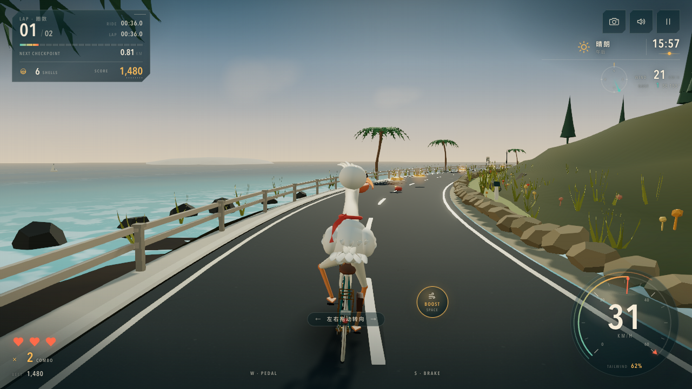
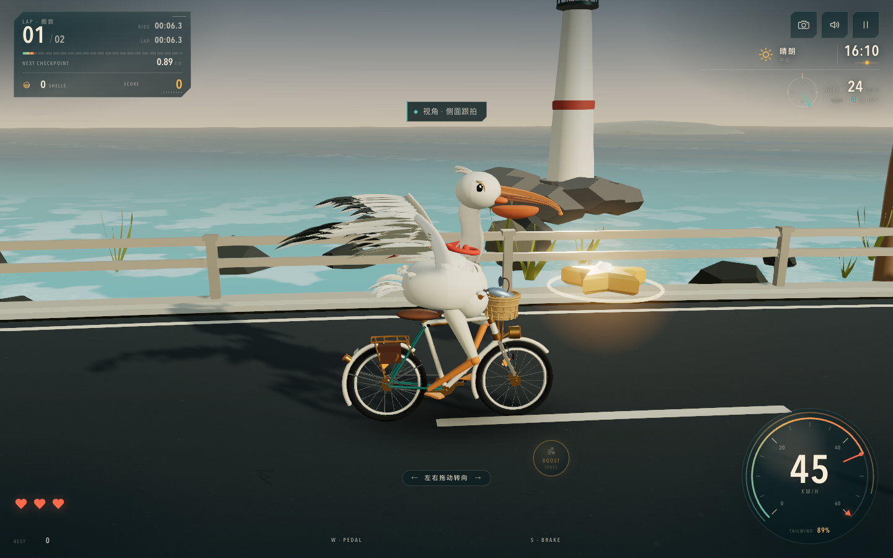

# 鹈鹕海岸线 · Pelican Coast

A stylized Three.js coastal cycling game. A pelican in a coral neckerchief pedals a vintage bicycle along a winding seaside road while wind, weather and the sun change around the ride.



**Play in browser:** https://yunxingwoo.github.io/pelican-coast/

## Quick start

```bash
npm install
npm run dev       # http://127.0.0.1:5199
npm run build     # production build in dist/
npm run preview   # http://127.0.0.1:5200
```

No external models, fonts, images or network calls are required at runtime. The pelican, bicycle, road, sea, sky, props and audio are built procedurally. Edge smoothing uses SMAA + 2× DPR on desktop, and the world uses smoother rock/cliff/tree geometry and a finer grain treatment.

## Controls

| Input | Action |
| --- | --- |
| `W` / `↑` | Pedal / accelerate |
| `S` / `↓` | Brake |
| `A` `D` / `←` `→` | Steer |
| `Shift` / `Space` | Tailwind boost (drains the boost meter) |
| Drag anywhere on the ride surface | Analog steering (mouse / touch) — no on-screen wheel |
| `C` / camera icon | Cycle chase → side → front → orbit → pelican POV cameras |
| On-screen pedals | Touch accelerate / brake |
| `P` / `Esc` | Pause / resume |
| `M` | Mute |
| `B` | Ring the handlebar bell |
| `T` | Spread / fold the pelican's wings |
| `N` | Fast-forward three hours |
| `U` | Hide / restore the interface |
| `R` | Restart after a finish or wipeout |
| Gamepad | Left stick steer, RT/LT throttle/brake, A boost, Start pause |

## The ride

- Two laps of a hand-built 0.96 km coastal circuit with headland bends, a lighthouse, checkpoint arch, start chequer and a finish line.
- **3 hearts.** Hit driftwood, rockfall or a crab and you lose speed, a heart and combo. Zero hearts ends the run; retry is instant.
- **Starfish shells** build a combo multiplier, recharge boost and add score. Laps award a split time and a bonus; final score is saved as your best.
- **Multiple showcase views:** `C` or the camera button cycles chase, side, front, slow cinematic orbit and a clean pelican POV. Press `U` to hide the whole interface for a cinematic view. There is no on-screen steering wheel; drag the road surface or use A/D.
- **Reference-inspired details:** `B` rings the bell, `N` jumps three hours through the day/night cycle, `T` spreads the wings while riding, and the POV camera hides the head/neck for a clean rider's-eye shot.
- **Wind** is simulated as a rotating bearing with layered gusts. It pushes you sideways, adds tailwind/headwind speed, and visibly bends grass, palms, flags and the windsock. The HUD compass, gust readout and warnings keep it legible.
- **Weather** transitions between clear, cloudy, rain, storm and sea fog. Rain reduces grip and darkens the road; storms add lightning, thunder, heavier seas and crosswind warnings; fog cuts visibility.
- **Day/night** runs on a 12-minute cycle from a warm afternoon through golden hour, sunset, night and dawn. Street lamps, the lighthouse beam, bike lamp and stars come up at dusk; the sun and moon move across a custom sky shader.
- **Procedural audio** (Web Audio): ocean ambience, speed-dependent wind, shell chimes, bell, wing whoosh, boost, crash impacts, thunder, checkpoint chords and a finish fanfare. The old chain tick has been removed.

## Deployment

The game is published to GitHub Pages at **https://yunxingwoo.github.io/pelican-coast/**.

Every push to `main` runs `.github/workflows/deploy.yml`, which installs dependencies, builds with Vite and deploys the `dist/` artifact using the official GitHub Pages actions. The build uses relative asset URLs (`base: './'`) so the same output also works under `npm run preview` locally.



## Architecture

```
src/
  game/Game.ts           run state, physics, input wiring, HUD snapshots, test hooks
  core/                  render pipeline (bloom + output), input, RAF loop
  entities/
    PelicanRider.ts      authored pelican + vintage bicycle rig and animation
    pelican/             shared materials and sweep/feather/part helpers
    TrackItems.ts        starfish shells, driftwood, rockfall, crabs
  world/
    TrackPath.ts         closed Catmull-Rom coast circuit
    Road.ts              asphalt ribbon, markings, guardrail, cliffs, terrain, hills
    Ocean.ts             tiled ocean shader with waves, foam and sun glitter
    Sky.ts               sky shader, sun/moon, stars, cloud sprites
    Environment.ts       day/night cycle, weather machine, wind model, lighting
    EnvironmentMap.ts    small painted PMREM environment for PBR reflections
    Props.ts             palms, cypress, grass, flowers, lighthouse, arch, signs, boats, gulls, windmill, windsock
    WeatherVfx.ts        rain, road splashes, lightning geometry
  systems/               camera rig, procedural audio
  ui/Hud.ts              data-driven HUD, screens, touch pads and drag steering
  styles.css             postcard × glass-cockpit design system
tests/gameplay.spec.ts   Playwright smoke tests (title → riding, HUD states)
```

## Verification

```bash
npx tsc --noEmit
npm run build
npx playwright test
npm run inspect:canvas -- --url http://127.0.0.1:5200 --state active-play --run-id pass-final
```

The test hooks used by the canvas inspector are exposed as `window.__THREE_GAME_TEST_HOOKS__` and diagnostics as `window.__THREE_GAME_DIAGNOSTICS__`.

## Known limitations

- Authored with procedural geometry, so surfaces are stylized rather than photoreal.
- The rig's folded feathers remain stylized; the spread wing uses layered primaries, secondaries, coverts and dark flight-feather tips without an underwing membrane.
- Mobile renders the same authored scene as desktop: it fits and runs, but the measurable draw-call/triangle budget is above the mobile starting budget.
- The chain line is static; lamps use emissive + bloom and only the bike headlamp is a real spotlight.
